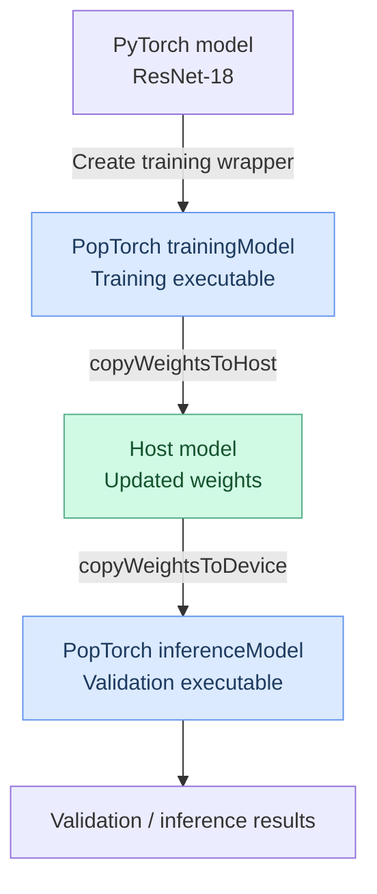

# Graphcore IPU Projects
We will report 
1) Programming IPUs with PyTorch/PopTorch — training, validation, model wrappers, and weight synchronization.
2) Comparing CNN and ViT architectures — classification performance on histopathology images.
3) Investigating IPU parallelization strategies — model parallelism, data parallelism, and hybrid parallelism.
## Task 1: Programming IPUs with PyTorch/PopTorch
**Poptorch:** PopTorch is a software library developed by Graphcore that allows PyTorch models to run on its Intelligence Processing Units (IPUs). 
It helps developers train and test deep learning models on IPUs with minimal changes to familiar PyTorch code, 
while supporting different ways of distributing computations across multiple IPUs. 
**Dataset:** camelyon17/wilds  
**Model:** ResNet-18 model  
>* Resnet18 model was tried first, being the smallest kind, to test a train model, a validation model and their weight transfer between the corresponding wrappers
>* A set of small datasets were randomly selected from the original camelyon17-wilds to speed up the training and avoid the OOM.
>* PyTorch / PopTorch training and validation workflow: 

Conceptual workflow: synchronize trained parameters back to the host and then into the validation executable.
                
## Task 2: Comparing CNN and ViT architectures
**Dataset:** camelyon17/wilds  
**Models:** ViT-Base, ViT-Small, ViT-Tiny, and ResNet-50  
**Model performance:**  
|model_name|	accuracy|	precision|	recall|	f1_score|	roc_auc|
|:---:|:---:|:---:|---:|---:|---:|
|resnet50	| 0.844 |	0.879 |	0.844 | 0.840 |	0.963 | 
|vit_base	| 0.962 |0.963 |	0.962 |	0.962 |	0.994 |
|vit_small | 0.962 |	0.962 |	0.962 |	0.962 |	0.992 |
|vit_tiny	| 0.914 	|0.922 |	0.914 | 	0.914 |	0.979 |

## Task 3: Investigating IPU parallelization strategies
**Dataset:** camelyon17/wilds  
**Models:** ViT-Small  
**Parallel processing modes:**  
| Modes |         Methods           | No. IPUs |   replication factor  | 	device iteration	| grad. accumulation |
|:---:|:---:|:---:|---:|---:|---:|
|model0  | model distributed         | 4 IPUs   |           1           |         4          |          32        | 
|model1  | model distributed         | 8 IPUs   |           1           |         8          |          32        | 
| data   | data distributed          | 8 IPUs   |           8           |         4          |           4        | 
| hybrid0 | model & data distributed  | 8 IPUs   |           2           |         4          |          16        | 
| hybrid1 | model & data distributed  | 8 IPUs   |           2           |         4          |          32        | 

**Performance of ViT_Small:**  
|parallel_mode	|accuracy	|precision	|recall	|f1_score|	roc_auc|
|:---:| :---:|:---:|:---:|:---:|:---:| 
|model0	|0.949	|0.951	|0.949	|0.949	|0.990|
|model1	|0.946	|0.949	|0.946	|0.946	|0.991|
|data	|0.895	|0.910	|0.895|	0.894|	0.976|
|hybrid0	|0.962	|0.962	|0.962	|0.962	|0.992|
|hybrid1	|0.960	|0.960	|0.960	|0.960	|0.992|

